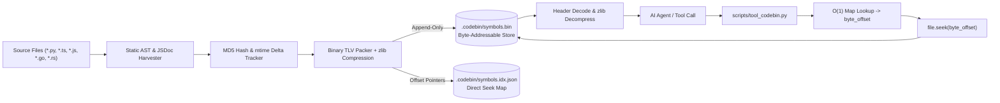

# CodeBin Technical Architecture & Skill Guide

CodeBin is a deterministic, low-latency binary symbol repository and $O(1)$ random-access codebase cache. It solves the LLM **Context Window Bottleneck** by eliminating repetitive raw source file ingestion, replacing multi-file text parsing with microsecond disk seeks.

---

## 1. Core Architecture Overview



---

## 2. Binary Layout Specification (TLV Protocol)

Every symbol record is stored in standard **Big-Endian network byte order (`>`)** with a fixed **53-byte header** followed by variable payload bytes.

### Header Byte Map (53 Bytes Total)

| Offset (Bytes) | Field Name | Struct Type | Size | Description |
|---|---|---|---|---|
| `0x00 - 0x03` | Magic Bytes | `4s` | 4 Bytes | Fixed signature: `b'CBIN'` |
| `0x04` | Format Version | `B` | 1 Byte | Current format: `0x02` |
| `0x05` | Status Flag | `B` | 1 Byte | `0x01` (Active), `0x02` (Modified), `0x03` (Removed / Tombstone) |
| `0x06` | Feature Flags | `B` | 1 Byte | Bit `0x01`: Payload is zlib compressed (`FLAG_ZLIB_COMPRESSED`) |
| `0x07` | Component Type | `c` | 1 Byte | `F` (Function), `C` (Class), `V` (Variable), `T` (Type/Interface), `M` (Method) |
| `0x08 - 0x0F` | Created Timestamp | `Q` | 8 Bytes | 64-bit unsigned Unix Epoch millisecond timestamp |
| `0x10 - 0x17` | Modified Timestamp | `Q` | 8 Bytes | 64-bit unsigned Unix Epoch millisecond timestamp |
| `0x18 - 0x27` | Content Hash | `16s` | 16 Bytes | MD5 fingerprint of the symbol definition AST segment |
| `0x28 - 0x29` | Qualified Name Len | `H` | 2 Bytes | Length of unique symbol path (`module/file.py::Class.method`) |
| `0x2A - 0x2B` | File Path Len | `H` | 2 Bytes | Length of normalized relative file path |
| `0x2C - 0x2D` | Signature Len | `H` | 2 Bytes | Length of formatted parameter and decorator signature |
| `0x2E - 0x31` | Line Number | `I` | 4 Bytes | Starting 1-based source line number |
| `0x32 - 0x35` | Description Len | `I` | 4 Bytes | 32-bit length of extracted docstring / JSDoc summary |

### Variable Payload (Uncompressed or zlib Deflated)
The trailing bytes contain:
```text
[Qualified Name Bytes] + [File Path Bytes] + [Signature Bytes] + [Description Bytes]
```
If `flags & 0x01` is active, the payload is transparently compressed using Python standard library `zlib.compress(level=6)`, yielding an average **65% to 80% reduction** in storage footprint.

---

## 3. O(1) Seek Operation & Memory Efficiency

Traditional file reading requires $O(N)$ scanning where $N$ is total lines of source code. When an LLM inquires about a symbol (e.g. `generateSessionToken`):

1. **Hash Table Lookup:** CodeBin consults `.codebin/symbols.idx.json` in $O(1)$ memory lookup to retrieve `byte_offset`.
2. **Direct Disk Teleportation:** The operating system positions the file pointer directly at `byte_offset` via `f.seek(offset)`.
3. **Microsecond Unpack:** Only the 53-byte header and the exact payload length are read from disk.
4. **Context Savings:** Only the symbol signature and description are returned to the agent prompt context.

---

## 4. Static Harvester & Multi-Language Extraction

To prevent arbitrary code execution vulnerabilities, **CodeBin never executes, imports, or evals source code**.

### Python Static AST (`ast.parse`)
- Extracts full decorator chains (`@app.get('/route')`, `@dataclass`, `@property`, `@staticmethod`).
- Captures `async def` and explicit return type annotations (`-> Result[T]`).
- Extracts inner class methods mapped hierarchically (`ClassName.method_name`).

### TypeScript / JavaScript / Go / Rust Harvester
- Harvests preceding multiline JSDoc blocks (`/** ... */`), Go doc comments (`// ...`), and Rust doc comments (`/// ...`).
- Parses `@param`, `@returns`, and `@deprecated` tags.
- Detects exported functions, arrow functions, struct declarations, interfaces, and type aliases.

---

## 5. Change Tracking, Tombstones & Compaction

CodeBin handles software evolution through an **append-only journal architecture**:

- **Unchanged Files:** Verified in $< 1\text{ms}$ via filesystem `mtime` and stored AST MD5 hashes.
- **Modified Symbols:** When a function's implementation or docstring changes, CodeBin appends a new record tagged `STATUS_MODIFIED (0x02)`, updates the timestamp, and points the index map to the latest byte offset.
- **Tombstoning (Deletions):** When a function is deleted from source, CodeBin appends a tombstone record tagged `STATUS_REMOVED (0x03)`. The agent is aware that the function existed previously and was deprecated or removed.
- **Compaction (`codebin compact`):** Purges historical overwritten versions and tombstoned entries, creating a defragmented `.bin` store and updating all index pointers.

---

## 6. Concurrency & Mutex Locking

To ensure thread safety when multiple agent turns or MCP tools invoke scans or queries simultaneously:
- **Windows:** Protected via `msvcrt.locking` with non-blocking retry loops.
- **POSIX (Linux/macOS):** Protected via `fcntl.flock(LOCK_EX / LOCK_SH)`.
- Prevents interleaved binary writes or dirty index state.

---

## 7. Model Context Protocol (MCP) Integration

CodeBin provides a native MCP stdio server (`scripts/mcp_server.py`) conforming to the JSON-RPC 2.0 specification:
- `tools/list`: Registers `codebin_lookup`, `codebin_search`, `codebin_scan`, and `codebin_status`.
- `tools/call`: Executes queries and returns concise JSON text payloads directly into agent reasoning loops.
